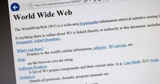

# Introduction To The Web Page:

## Frist Web Page:

- The Frist Web Page Is Created , And Developed By The British Scientist Tim Berners Lee In 1989.
- Tim Berners Lee Uses HTML Language Only To Build The Structure Of The Frist Web Page.
- The Frist Web Page Contains Some Heading Levels , Paragraphs , Image , And More Without Any Styling , Or Decorations.
- The Frist Web Page Is A Non Graphical Web Page.
- Tim Berners Lee Does Not Use Any Language Else HTML Language Like CSS Language To Make The Styling , And Decorations Of The Frist Web Page.

| World Wide Web | First Web Page |
|  |  |

-----------------------------------------------
## Second Web Page:

- The Second Web Page Is Created , And Developed By A Group Of Students In The Graduation Project In The Computer Science Faculty In 1993.
- A Group Of Students Use HTML Language (Building The Structure Of The Second Web Page) , And Also CSS Language (Making The Styling , Or Decorations Of The Second Web Page).
- The Second Web Page Is A Graphical Web Page , Because A Group Of Students Using HTML Language , And CSS Language Also.

-------------------------------------------------
>[!Important]
> Frist Web Page Created By Only The HTML Language.

> Second Web Page Created By Only The HTML Language , And Styling , Or Decorate By The CSS Language.

--------------------------------------------------
>[!Tip]
> Frist Web Page Is A Non Graphical Web Page.

> Second Web Page Is A Graphical Web Page.
