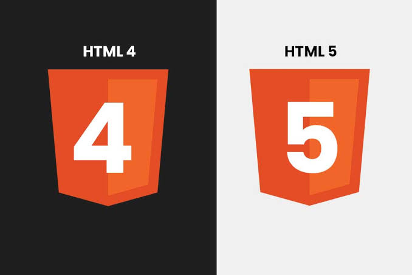
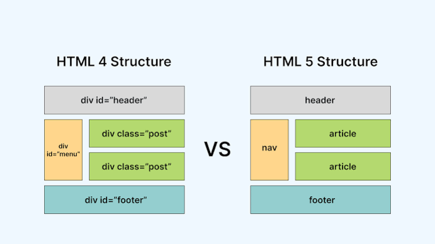

# Introduction To The HTML Language:
------------------------------------
- HTML: It Refers To The Hyper Text Markup Language...
- HTML: It Is The Main , And Frist Language To Build The Structure Of Your Own HTML Document (Own Web Page)...
- HTML: It Is Not A Programming Language , But It Is A Markup Language...
- HTML: It Is A Standard Language , Because You Can Not Replace The HTML Language With Any Language To Build The Structure Of Your Own HTML Document (Own Web Page)...
- HTML: It Has More Than One Versions Like HTML V3 , HTML V4 , And Finally HTML V5...

------------------------------------------

<table>
  <tr>
    <td>
      <strong>HTML V4 VS HTML V5</strong>
       
      
    </td>
    <td>
      <strong>HTML V4 VS HTML V5</strong>
       
      
    </td>
  </tr>
</table>

--------------------------------------------
>[!important]
>HTML Is A Standard , This Means That You Can Not Replace The HTML Language With Any Language To Build The Structure Of Your Own HTML Document (Own Web Page) , But The CSS Language Is Not A Standard Language , Because You Can Replace CSS Language With Any Styling Libraries , Or Decorations Libraries Like BootStrap CSS , Or Tailwind CSS To Make The Styling , Or Decorations Of Your Own HTML Document (Own Web Page)...

----------------------------------------------
