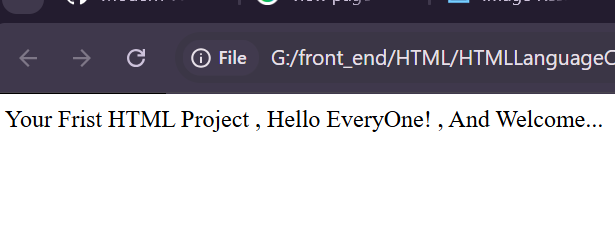
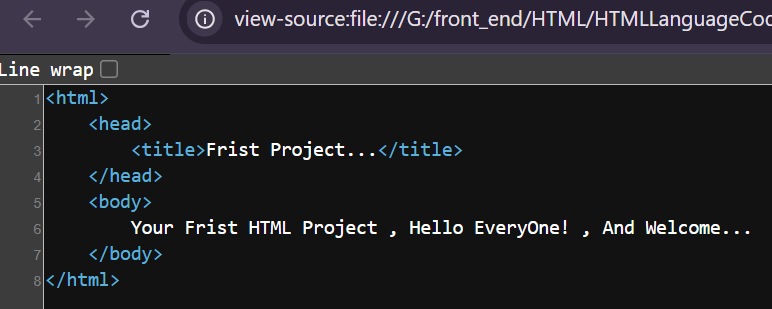
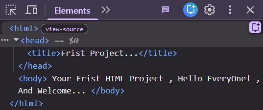
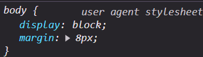

# Elements And Browsers:
--------------------------
- View Page Source: Control (CTRL) + "U": It Is Mainly Used To Get The Page Source Codes Of Your Own HTML Document (Own Web Page)...
<table>
  <tr>
    <td>
      <Strong>Own HTML Document...</Strong>
      
    </td>
    <td>
      <strong>View Page Source...</strong>
      
    </td>
  </tr>
</table>

- Inspect: It Is Mainly Used To Know The Type Of Different HTML Elements That Mainly Used To Build The Structure Of Your Own HTML Document (Own Web Page)...
<table>
  <tr>
    <td width="75%">
      <Strong style="text-align: center;">Inspect Of Your Own HTML Document...</Strong>
      
    </td>
  </tr>
</table>

- UA Stylesheet: It Refers To The User Agent Stylesheet , It Is The CSS Custom Styling , Or The CSS Custom Decorations For Different HTML Elements From The HTML Language To Distinguish Between Different HTML Elements...
<table>
  <tr>
    <td width="75%">
      <strong style="text-align: center;">User Agent Stylesheet</strong>
       
      
    </td>
  </tr>
</table>

- SEO: It Refers To The Search Engine Optimization , It Is Mainly Used To Improve Your Own HTML Document (Own Web Page) , So That It Appears In The Frist Searching Engine Results Like Google Chrome , Firefox Developer Edition , And More...

  <table>
    <tr>
      <td>
        <strong>Searching Engines Optimization...</strong>
         
        
      </td>
      <td>
        <strong>Search Engines Optimization...</strong>
         
        
      </td>
    </tr>
  </table>

- Web Accessibility: It Is The Process Of Practicing Of Designing , And Developing Your Own HTML Document (Own Web Page) , So That Everyone Can Use Your Own HTML Document (Own Web Page) Including People With Disabilities...
 
<table>
  <tr>
    <td>
      <strong>Web Accessibility...</strong>
       
      
    </td>
    <td>
      <strong>Web Accessibility...</strong>
       
      
    </td>
  </tr>
</table>
