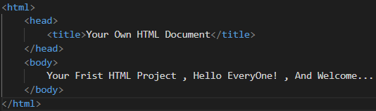
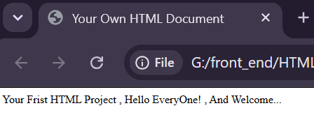

# Your Frist Web Page (Frist HTML Document):

------------------------------------------------------
- The Frist HTML Document File Should Name With "Index.html" , Because When Uploading Your Own Project In Any Server , Different Browsers Like Google Chrome , Firefox Developer Edition , Or ETC Is Searching For File With Index Name To Start Archiving , Or Rendering Your Project From This Point , Because It Is The Entry Point , Or Starting Point...
    - Index: It Refers To The Frist HTML Document File Name...
    - .html: It Refers To The Extension Of The Frist HTML Document File To Know Different Users , Developers , Operating Systems Like Mac OS , Windows , Linux That It Is A HTML File...
- You Should Format Different HTML Codes Of Your Own HTML Document File To Make Your HTML Codes Formatting , Cleaning , Styling , Easy For Different Users , Developers To Read , And Understand This HTML Codes , And Finally , There Are Many Different Formatting , And Styling Ways Like:
    - Tab: It Is Mainly Used To Make A One Step Forward In Your Own HTML Document (Own Web Page)...
    - Shift Tab: It Is Mainly Used To Make A One Step Backward In Your Own HTML Document (Own Web Page)...
    - Alt Shift Arrow UP: It Is Mainly Used To Take A Copy From The HTML Line Code In The Top...
    - Alt Shift Arrow Down: It Is Mainly Used To Take A Copy From The HTML Line Code In The Bottom...
- Any HTML Document (Web Page) Mainly Consists Of Three Main HTML Elements (HTML , HEAD , And Finally BODY) That Mainly Used To Make The Structure Of Your Own HTML Document (Own Web Page)...
- Different HTML Elements From The HTML Language Called HTML Tags...
- ## HTML Tag:
    - It Refers To The Hyper Text Markup Language...
    - It Represents The Root Of Your Own HTML Document (Own Web Page)...
    - It Contains All HTML Codes Of Your Own HTML Document (Own Web Page)...
- ## HEAD Tag:
    - It Refers To The Head Of Your Own HTML Document (Own Web Page)...
    - It Represents A Collection Of Different MetaData For Your Own HTML Document (Own Web Page) To Know Different Browsers Like Google Chrome , Firefox Developer Edition , Or ETC Like TITLE Tag , And More...
    - Different HTML Contents Inside The HEAD Tag Does Not Appear For Different Users Of Your Own HTML Document (Own Web Page) , Because It Is A Collection Of Instructions , Or Information About Information For Different Browsers Like Google Chrome , Firefox Developer Edition , Or ETC How To Archive , Or Render Your Own HTML Document (Own Web Page)...
- ## BODY Tag:
    - It Refers To The Body Of Your Own HTML Document (Own Web Page)...
    - It Represents To Different Contents Of Your Own HTML Document (Own Web Page)...
    - It Is The Visible Part Of Your Own HTML Document (Own Web Page) That Appears For Different Users Of Your Own HTML Document (Own Web Page) When Rendering , Or Archiving By Different Browsers Like Google Chrome , Firefox Developer Edition , Or ETC...
- ## TITLE Tag:
    - It Refers To The Title Of Your Own HTML Document (Own Web Page)...
    - You Must Use TITLE Tag Inside HEAD Tag Inside HTML Tag In Your Own HTML Document (Own Web Page)...
    - It Does Not Appear For Different Users In Your Own HTML Document (Own Web Page) , But It Appears In The Top Left In The Searching Tab In Different Browsers Like Google Chrome , Firefox Developer Edition , Or ETC , And Also Appears In The Searching Results In Different Browsers Like Google Chrome , Firefox Developer Edition , Or ETC...

-------------------------------------------------------------------------

<table>
    <tr>
        <td>
            <strong>Own HTML Document Codes</strong>
             
            
        </td>
        <td>
            <strong>Own HTML Document Rendering</strong>
            
        </td>
    </tr>
</table>

-----------------------------------------------------------------------------------
>[!Important]
>HTML Contains All HTML Codes Of Your Own HTML Document...
>Head Contains A Collection Of MetaData For Your Own HTML Document...
>Body Contains Different Contents Of Your Own HTML Document That Appears For Different Users...

-------------------------------------------------------------------------------------
>[!Tip]
>MetaData Refers To Collection Of Instructions , Or Information About Information For Different Browsers Like Google Chrome , Firefox Developer Edition To Know How To Archive , Or Render Your Own HTML Document (Own Web Page) But It Is Not Content That Appears For Different Users Of Your Own HTML Document (Own Web Page)....
>Content Inside TITLE HTML Tag Is Not Appear For Different Users Of Your Own HTML Document (Own Web Page) But It Appears If The Searching Tab In The Top Left Of Any Browser Like Google Chrome , Firefox Developer Edition...

--------------------------------------------------------------------------------------
>[!Warning]
>TITLE HTML Tag Must Use Inside HEAD HTML Tag Inside HTML Tag Of Your Own HTML Document (Own Web Page).
